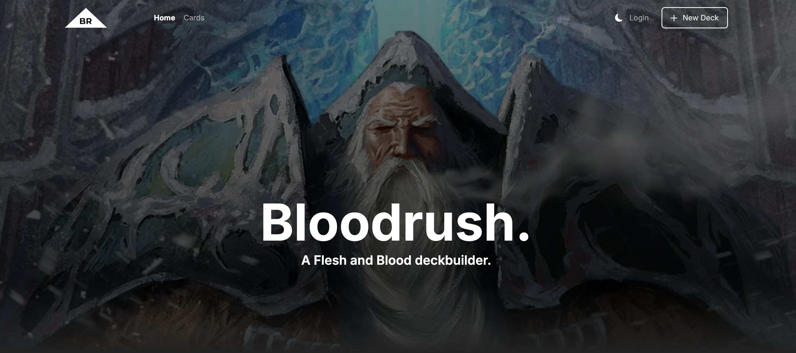

# Bloodrush

Bloodrush is FAB deckbuilding project. At one stage it was hooked up to a private data repo for FAB source card data, with auth and account management all running. It had a scripting project to map that source data into its own internal database in the schema defined by the local prisma file. You could create decks and they would display on the homepage. Next step was to implement a decks search feature.

It's since been abandoned. I'm leaving it here for posterity.

